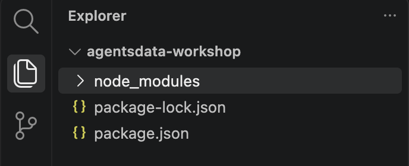

# Step-by-step Guide — Agent-based Sales Dashboard

This repository contains the step-by-step guide for a practical workshop. You do not work inside it: you start from an empty folder on your machine and create the dashboard, agent instructions, and integrations progressively during the exercises. The setup scripts and the sample data are downloaded from the [latest release](https://github.com/carlos-peiro-ntt/agentsdata/releases/latest).

The goal is to start from zero and iterate on a simple business dashboard to understand the difference between:

- requesting a solution with a prompt;
- providing real data;
- defining persistent instructions in `AGENTS.md`;
- adding specialized skills;
- connecting external tools through MCP;
- planning and executing a complete delivery.

> The guide shows commands for **Windows 10/11 with PowerShell** and for **WSL, Linux, and macOS with Bash/Zsh**. Linux commands assume an Ubuntu/Debian-based distribution.

## Before the Course

Complete these steps on your own before the live session. They only install tools and prepare an empty folder; the exercises themselves are done together during the course.

> [!IMPORTANT]
> **Do not clone, fork, or download this repository.** The `part-1/` folder is the final snapshot of the Part 1 project folder, published only so you can compare your result after the course. Everything you need is in this guide and in the release downloads.

### 1. Install the prerequisites

Download the scripts for your system from your browser, with one click each:

| System | Setup script | Secrets script (used in Exercise 3) |
| --- | --- | --- |
| macOS, Linux, or WSL | [setup.sh](https://github.com/carlos-peiro-ntt/agentsdata/releases/latest/download/setup.sh) | [setup-secrets.sh](https://github.com/carlos-peiro-ntt/agentsdata/releases/latest/download/setup-secrets.sh) |
| Windows | [setup.ps1](https://github.com/carlos-peiro-ntt/agentsdata/releases/latest/download/setup.ps1) | [setup-secrets.ps1](https://github.com/carlos-peiro-ntt/agentsdata/releases/latest/download/setup-secrets.ps1) |

Keep both files in your Downloads folder; you will need the secrets script again in Exercise 3. The setup installs missing system prerequisites and creates `~/agentsdata-workshop` (Windows: `$HOME\agentsdata-workshop`), including its project-local `node_modules` with pinned OpenSpec and skills packages. It also prepares Python 3.12 for the Confluence MCP and verifies the setup; see [Setup and Workshop Preparation](docs/part-1/setup.md) for troubleshooting.

```bash
# macOS or Linux
bash ~/Downloads/setup.sh

# WSL (the browser saves files to the Windows Downloads folder)
bash /mnt/c/Users/<windows-user>/Downloads/setup.sh
```

### Windows 10/11 — step by step

1. Before installing, request local administrator rights through [Local Admin Rights Request — Employee Center](https://help.nttltd.global.ntt/esc?id=sc_cat_item&sys_id=2288d30d97447ed0495cb077f053af25). Wait for approval; elevation may be required if Node.js needs to be installed.
2. Download `setup.ps1` and `setup-secrets.ps1` using the links in the table and keep them in `Downloads`. Do not download or clone this repository.
3. Open **PowerShell** or **Windows Terminal** as administrator using your company's approved elevation process.
4. Run setup from PowerShell:

    ```powershell
    powershell.exe -NoProfile -ExecutionPolicy Bypass -File "$HOME\Downloads\setup.ps1"
    ```

5. Wait for the final summary. Required checks must show `OK`; Codex may show `WARN` because it is optional. If setup just installed tools, close and reopen the terminal.
6. Open the folder created by setup:

    ```powershell
    code "$HOME\agentsdata-workshop"
    ```

7. If PowerShell later blocks npm's shim, run workshop tools from the integrated terminal using `npm.cmd`, for example `npm.cmd exec -- openspec --version`.

The setup is a PowerShell script (`.ps1`); there is no `setup.cmd`.

To verify without installing, add `--check` (Bash) or `-Check` (Windows):

```cmd
powershell.exe -NoProfile -ExecutionPolicy Bypass -File "$HOME\Downloads\setup.ps1" -Check
```

Required checks must end with `OK`; Codex may show `WARN` when it is not installed because it is optional.

Then open VS Code, sign in to GitHub Copilot, and check that you can send a message in the chat. Codex is optional: the setup detects whether it is already installed and does not fail if it is absent.

### 2. Open your working folder

The setup script already created the project folder and installed dependencies there. Open that same folder in VS Code; do not create a second empty folder. `node_modules` is inside it. On Windows, use `npm.cmd exec --` for workshop tool commands if PowerShell blocks npm's `.ps1` shim. Every exercise happens inside this folder; it does not need Git or any file from this repository.

```bash
# macOS, Linux, or WSL
code ~/agentsdata-workshop
```

```powershell
code "$HOME\agentsdata-workshop"
```

You can also open it with **File → Open Folder** in VS Code. From now on, "project folder" refers to `agentsdata-workshop`.

Before the course, the folder contains the pinned npm manifests and dependencies. Exercise files such as `AGENTS.md`, `dashboard.html`, `resources/`, `.mcp.json`, and `openspec/` are created during the workshop, not by setup.

### Ready checklist

- [ ] The setup script ends with every check `OK`.
- [ ] `setup-secrets` is saved in your Downloads folder.
- [ ] GitHub Copilot chat answers in VS Code. Codex is optional.
- [ ] `agentsdata-workshop` is open in VS Code and contains the setup files and `node_modules`.

> [!WARNING]
> **Stop here.** Do not start the exercises in advance: they are done step by step during the live course, where the sample data is introduced and the tokens are shared.

After completing the **Before the Course** steps, the open project folder should look like this:

<!-- markdownlint-disable MD033 -->
<p align="center">
  
</p>
<!-- markdownlint-enable MD033 -->

## During the Course

### Part 1 — From Prompt to Specification-Driven Development

Work through the exercises in order, following the instructor. Each one builds on the files created by the previous step. Every exercise shows the GitHub Copilot steps; where Codex works differently, expand the collapsible **Codex** block.

1. [Exercise 1 — Create the First Dashboard](docs/part-1/exercise-01-dashboard.md) — prompt-only generation, then generation from real CSV data.
2. [Exercise 2 — From Prompt to AGENTS.md](docs/part-1/exercise-02-agents-md.md) — create `AGENTS.md`.
3. [Exercise 3 — Skills, MCP, Instructions, Planning, and Implementation](docs/part-1/exercise-03-skills-mcp-instructions.md) — install skills, configure MCP servers, add the dashboard instruction, plan and implement the Supabase-backed dashboard.
4. [Exercise 4 — Propose and Apply a Change with OpenSpec](docs/part-1/exercise-04-openspec-propose-apply.md) — initialize [OpenSpec](https://github.com/Fission-AI/OpenSpec), turn an idea into a reviewed change under `openspec/changes/`, and implement it with `/openspec-apply-change`.
5. [Exercise 5 — Verify, Test, and Archive](docs/part-1/exercise-05-verify-harness-archive.md) — verify the implemented change, validate it with `evals/eval.js`, then archive it.

### Part 2

Coming soon.

## Repository Layout

```text
README.md          course index (this file)
docs/
  part-1/          Part 1 setup guide and exercise guides
  part-2/          Part 2 guides (coming soon)
scripts/           Part 1 setup and secrets scripts, published as release downloads (maintainer guide: scripts/README.md)
part-1/            final state of the Part 1 project folder; open it as its own VS Code workspace
part-2/            final state of the Part 2 project folder; open it as its own VS Code workspace
```

Each `part-N/` folder is a complete project folder: its `AGENTS.md`, `.github/`, `.agents/`, `.codex/`, `.mcp.json`, and `openspec/` are only picked up when that folder is opened as the workspace root (`code part-1`).

## Data Progression

The workshop moves through three data stages, and each exercise states which one applies:

1. No data — the agent has to invent values.
2. CSV files downloaded as [`resources.zip`](https://github.com/carlos-peiro-ntt/agentsdata/releases/latest/download/resources.zip) during Exercise 1 and extracted into `resources/` in your project folder — real but temporary sample data, used only to learn the flow. These files are removed once Supabase becomes the source of truth.
3. Supabase (via MCP, read-only) — the authoritative source for the rest of the workshop. The Supabase tables mirror the same schema and names as the earlier CSV files. The token is provided during the live course.
